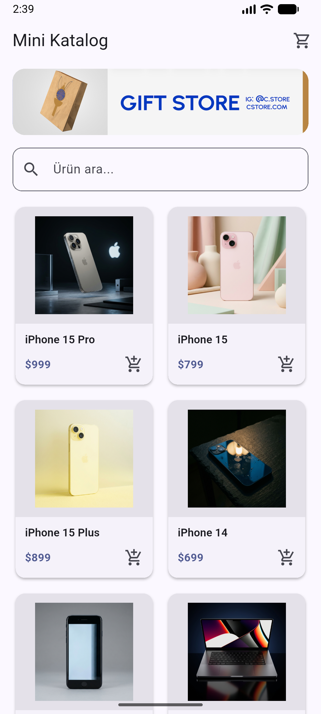
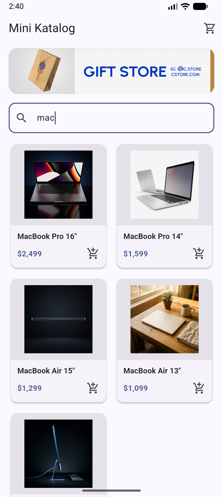
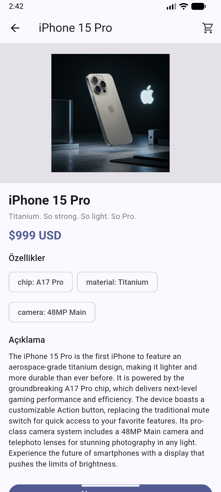
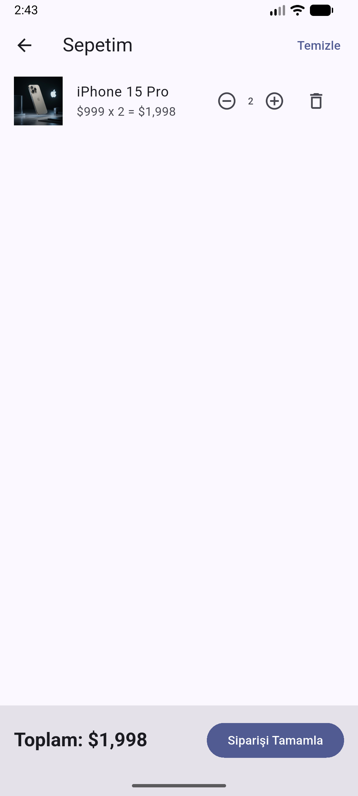

# Mini Katalog Uygulaması

Flutter ile geliştirilmiş basit bir ürün katalog uygulamasıdır. Ana sayfada banner, arama kutusu ve `GridView` ile ürün kartları bulunur; bir ürüne dokununca detay sayfası açılır ve sepete ekleme simülasyonu yapılabilir.

Bu proje, Flutter eğitimi kapsamında widget yapısı, sayfa geçişleri, JSON/model kullanımı ve temel state yönetimini göstermek için hazırlanmıştır. **Ekstra paket kullanılmamıştır**, yalnızca Flutter SDK (`material.dart`) kullanılır.

## Ekran Görüntüleri

Görüntüler Android emülatöründe (Medium Phone, Android 17) çalışan uygulamadan alınmıştır.

| Ana Sayfa | Arama | Ürün Detayı | Sepet |
|---|---|---|---|
|  |  |  |  |

## Özellikler

- **Ana sayfa:** `Image.asset` ile banner, `GridView` ile 2 sütunlu ürün kartları.
- **Arama / filtreleme:** Ürün adı veya sloganına göre anlık filtreleme.
- **Ürün detayı:** `Navigator.pushNamed` ve **route arguments** ile seçilen ürün detay sayfasına taşınır; özellikler ve açıklama gösterilir.
- **Sepet (simülasyon):** Sepete ekle butonu, AppBar'da ürün adedi rozeti, `ListView.builder` ile sepet listesi, adet artırma/azaltma, silme ve toplam tutar. Durum `ChangeNotifier` ile güncellenir.
- **Model ve JSON:** `Product` sınıfı `fromJson` / `toJson` içerir; ürünler `assets/data/products.json` dosyasından okunur (API simülasyonu).
- **Named routes:** `/` (ana sayfa), `/detail` (detay), `/cart` (sepet).

## Kullanılan Sürümler

| Araç | Sürüm |
|---|---|
| Flutter | **3.47.9** (stable) |
| Dart | 3.13.7 |

## Çalıştırma Adımları

Gereksinimler: [Flutter SDK](https://docs.flutter.dev/get-started/install), Android Studio (Android SDK ve emülatör için) ve bir Android emülatör ya da fiziksel Android cihaz.

```bash
# 1. Projeyi indirin
git clone https://github.com/irfankubus/mini_katalog.git
cd mini_katalog

# 2. Bağımlılıkları indirin
flutter pub get

# 3. Çalıştırın (emülatör açık ya da cihaz bağlı olmalı)
flutter run
```

Ortamınızı kontrol etmek için `flutter doctor` çalıştırabilirsiniz. Testleri ve kod analizini çalıştırmak için:

```bash
flutter test
flutter analyze
```

## Proje Yapısı

```
mini_katalog/
├── assets/
│   ├── data/products.json        (ürün verisi, JSON)
│   └── images/                   (banner ve ürün görselleri)
├── lib/
│   ├── main.dart                 (uygulama ve named routes)
│   ├── data/product_repository.dart
│   ├── models/
│   │   ├── product.dart          (Product modeli, fromJson/toJson)
│   │   └── cart.dart             (sepet durumu)
│   ├── screens/
│   │   ├── home_page.dart
│   │   ├── product_detail_page.dart
│   │   └── cart_page.dart
│   └── widgets/
│       ├── product_card.dart
│       └── cart_button.dart
├── screenshots/
└── test/widget_test.dart
```

## Veri Kaynağı

Ürün verileri ve görselleri, eğitim amaçlı sunulan `wantapi.com` sahte (mock) verisinden alınmış ve projeye yerel olarak eklenmiştir. Ürün adları ve markalar ilgili sahiplerine aittir. Bu veriler gerçek bir e-ticaret altyapısını temsil etmez.
